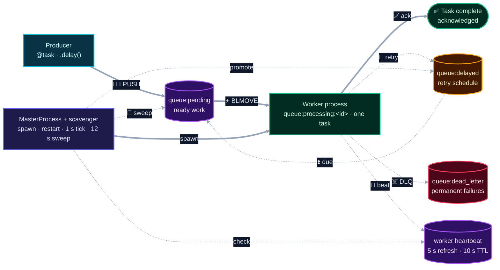

# PyQueue

**Distributed task execution for Python.**

PyQueue moves slow or failure-prone work out of the request path. Tasks are serialized with MessagePack, queued in Redis, and executed by a pool of worker processes. A supervisor keeps the pool healthy, while a heartbeat-driven scavenger recovers work from workers that disappear mid-task.


> **Status:** Core execution engine complete. Dispatch, supervision, recovery, retries, and dead-lettering are implemented, with unit coverage for the protocol and registry plus a crash-recovery test for orphan reclaim.

---

## Why PyQueue

Task queues are simple until a worker dies. PyQueue is built around that moment.

Every task is moved atomically into an in-flight list before execution. Every worker holds a heartbeat lease. If the process disappears, the lease expires and the task is returned to the queue. Retries are bounded, failures land in a dead-letter queue, and shutdown gives in-flight work a chance to finish.

The engine uses Redis for coordination, OS processes for parallelism, and MessagePack for a compact wire format. Redis is the only external service.

Typical workloads include email and notifications, report generation, webhook delivery, media processing, and calls to external APIs.

---

## At a Glance

| Property | Value |
|---|---|
| **Runtime** | Python 3.14 |
| **Broker** | Redis 8.1 |
| **Serialization** | MessagePack |
| **Task IDs** | UUID7 |
| **Execution model** | Process-per-worker; one task at a time per worker |
| **Delivery guarantee** | At-least-once |
| **Retries** | Exponential backoff; 3 retries by default |
| **Heartbeat** | 5 s refresh; 10 s TTL |
| **Recovery sweep** | Every 12 s |
| **Graceful shutdown** | 5 s total drain window |

---

## Architecture



Solid lines show the normal execution path. Dashed lines show retries, heartbeats, and recovery.

### The moving parts

| Layer | Responsibility |
|---|---|
| **Producer** | Registers task functions with `@task`, builds a `TaskMessage`, and calls `.delay(...)` |
| **Redis broker** | Holds pending work, per-worker in-flight lists, delayed retries, dead letters, and heartbeat keys |
| **Worker** | Moves a task from pending to its own processing list, executes it, then acknowledges, retries, or dead-letters it |
| **Master** | Spawns the worker pool, polls process health, restarts dead workers, and handles shutdown signals |
| **Scavenger** | Promotes due retries every second and returns orphaned tasks to pending every twelve seconds |

---

## How a Task Moves

1. **Register.** `@task` adds the function to the registry under its `module.function` name.
2. **Enqueue.** `.delay(...)` builds a `TaskMessage`, serializes it with MessagePack, and runs `LPUSH queue:pending`.
3. **Claim.** A worker runs `BLMOVE` to atomically move the task into `queue:processing:<worker>:<pid>`.
4. **Execute.** The worker looks up the function in its registry and runs it. Sync handlers run inline; async handlers run with `asyncio.run`.
5. **Acknowledge.** On success, `LREM` removes the task from the worker’s processing list.
6. **Retry.** On failure, `retries` is incremented, the task is scheduled in `queue:delayed` with a `2 ** retries` second delay, and the scavenger promotes it when due.
7. **Isolate.** After the retry limit, the task is pushed to `queue:dead_letter`.
8. **Recover.** If a worker dies, its heartbeat expires. The scavenger finds the orphaned processing list and moves its tasks back to pending.

---

## Reliability Model

| Concern | Mechanism |
|---|---|
| Crash-safe dequeue | `BLMOVE` moves the task and records it in the worker’s processing list in one atomic operation |
| Worker failure detection | Each worker refreshes a heartbeat key every 5 seconds with a 10-second TTL |
| Orphan recovery | The scavenger scans `queue:processing:*` every 12 seconds and reclaims lists whose heartbeat is missing |
| Retry handling | Exponential backoff with a bounded retry count |
| Poison-pill isolation | Exhausted tasks move to `queue:dead_letter` |
| Graceful shutdown | A shared shutdown event stops new work; the master drains the pool for up to 5 seconds before terminating stragglers |
| Duplicate delivery | Possible by design; handlers should be idempotent |

> **Delivery contract:** PyQueue is at-least-once. A task can run more than once after a crash, an acknowledgement failure, or a reclaim. Handlers that touch external systems should be idempotent and keyed by a stable business identifier.

---

## Quick Start

**Prerequisites:** Python 3.14+, [uv](https://docs.astral.sh/uv/), and Redis 8.x running on `localhost:6379`.

```bash
# From the repository root
uv sync

# Terminal 1 — start the supervisor and worker pool
uv run python -m pyqueue worker --concurrency 4 --import pyqueue.demo

# Terminal 2 — enqueue the demo tasks
uv run python -m pyqueue.run_demo
```

The demo enqueues a fast sync task, an async task, a task that fails twice before succeeding, and a task that always fails so you can watch it reach the dead-letter queue in Redis.

### Run the tests

```bash
uv run pytest
```

The test suite includes a crash-recovery test that kills a worker while it holds a task, then verifies that the scavenger returns the task to the pending queue. The test requires Redis and skips cleanly when Redis is unavailable.

---

## Usage

Define a task in a module that the worker can import:

```python
# app/tasks.py
from pyqueue.task import task


@task
def send_email(address: str, subject: str) -> None:
    # Replace with your mail provider.
    print(f"sending {subject!r} to {address}")
```

Enqueue it from application code:

```python
from app.tasks import send_email

task_id = send_email.delay("user@example.com", subject="Welcome")
print(task_id)
```

Start a worker that loads the module:

```bash
uv run python -m pyqueue worker --concurrency 4 --import app.tasks
```

Async handlers work the same way:

```python
@task
async def fetch_profile(user_id: int) -> dict:
    ...
```

`--import` can be repeated, or you can set `PYQUEUE_TASKS=app.tasks,app.reports`. The worker must be able to import the module that defines the task.

---

## Demo Tasks

| Task | What it demonstrates |
|---|---|
| `add(2, 3)` | A fast synchronous handler |
| `fetch_data("demo")` | An async handler using `asyncio.sleep` |
| `flaky(run_id)` | Retry with exponential backoff before success |
| `poison(run_id)` | Exhausted retries and dead-lettering |

`uv run python -m pyqueue.run_demo` enqueues one of each.

---

## CLI

```bash
pyqueue worker [--concurrency N] [--import MODULE] [--log-level LEVEL]
```

| Option | Description |
|---|---|
| `-c`, `--concurrency` | Number of worker processes. Defaults to the CPU count. |
| `--import` | Task module to load in the workers. Repeatable. |
| `--log-level` | `DEBUG`, `INFO`, `WARNING`, `ERROR`, or `CRITICAL`. Default: `INFO`. |

| Environment variable | Description |
|---|---|
| `PYQUEUE_TASKS` | Comma-separated task modules, used when `--import` is not provided |
| `PYQUEUE_LOG_LEVEL` | Log level for worker processes |

Redis host, port, database, key names, and timing constants live in `src/pyqueue/config.py`.

---

## Testing

```bash
uv run pytest
```

| Test | Coverage |
|---|---|
| `tests/test_task.py` | Message envelope defaults, MessagePack round-trip, task registration |
| `tests/test_chaos.py` | Kill a worker mid-task and verify scavenger recovery |

The chaos test starts a real worker process, enqueues a long-running task, kills the process, and waits for the orphaned task to return to `queue:pending`.

---

## Project Layout

```text
src/pyqueue/
├── broker.py       Redis operations: enqueue, dequeue, ack, retry, DLQ
├── worker.py       Dequeue → execute → acknowledge/retry/dead-letter
├── master.py       Worker supervision, signal handling, respawn
├── scavenger.py    Delayed promotion and orphan reclaim
├── heartbeat.py    Worker identity and liveness leases
├── message.py      TaskMessage and MessagePack serialization
├── task.py         @task decorator, registry, module loading
├── config.py       Redis endpoint, keys, intervals, TTLs
├── cli.py          `pyqueue worker` entry point
├── demo.py         Example tasks used by the demo
├── tasks.py        Long-running task used by the chaos test
├── run_demo.py     Demo producer
└── log.py          Process-aware logging

tests/
├── test_task.py
└── test_chaos.py

docs/
├── PyQueue-Architecture.md
└── PyQueue-Architecture-Simplified.md
```

---

## Design Notes

- **Atomic handoff.** `BLMOVE` is the commit point. A task is never removed from the queue without being recorded in a processing list.
- **Per-worker ownership.** Each worker owns its own processing list, so acknowledgement and recovery are targeted rather than global scans.
- **Lease-based liveness.** Heartbeats are TTL keys. A crashed process cannot clean up after itself, so expiration is the failure signal.
- **Explicit recovery.** The scavenger is a small, separate loop responsible for two things: promoting delayed work and reclaiming orphaned work.
- **Processes plus async.** Worker processes provide CPU parallelism across the GIL; `asyncio` gives individual I/O-bound handlers a non-blocking execution path.
- **Compact wire format.** MessagePack keeps task payloads small while preserving Python’s basic types.

---

## Extending PyQueue

The core engine focuses on execution: enqueue, dispatch, recovery, retries, and dead-lettering. Result storage, task-status APIs, queue routing, priorities, and operational dashboards can be layered on without changing the core execution path.
